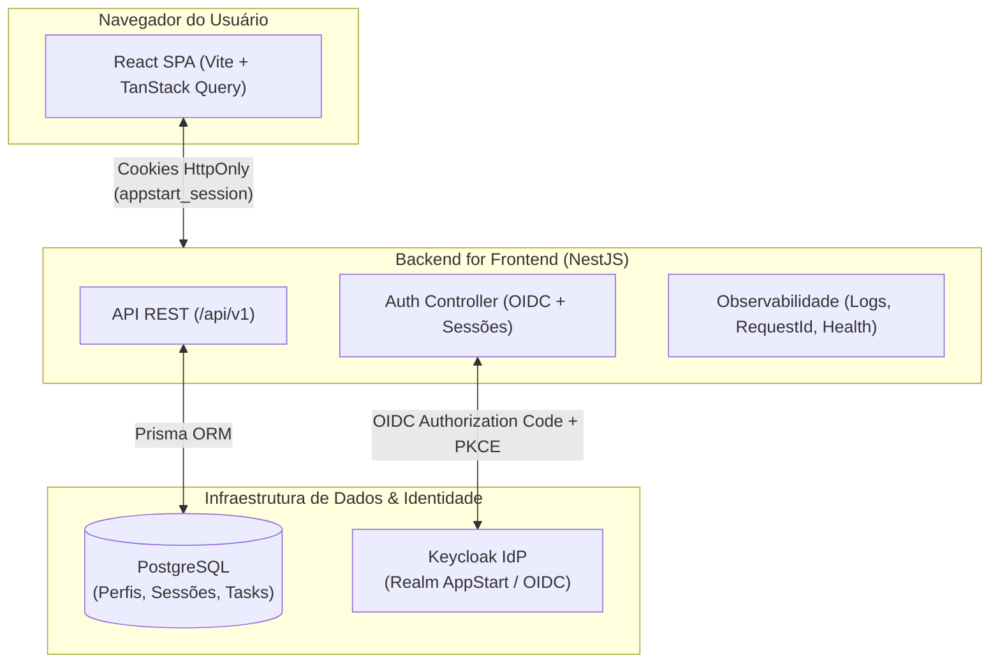
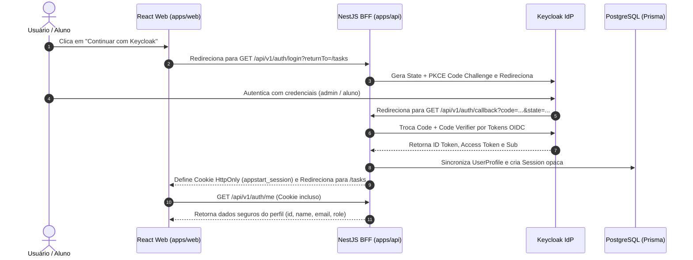
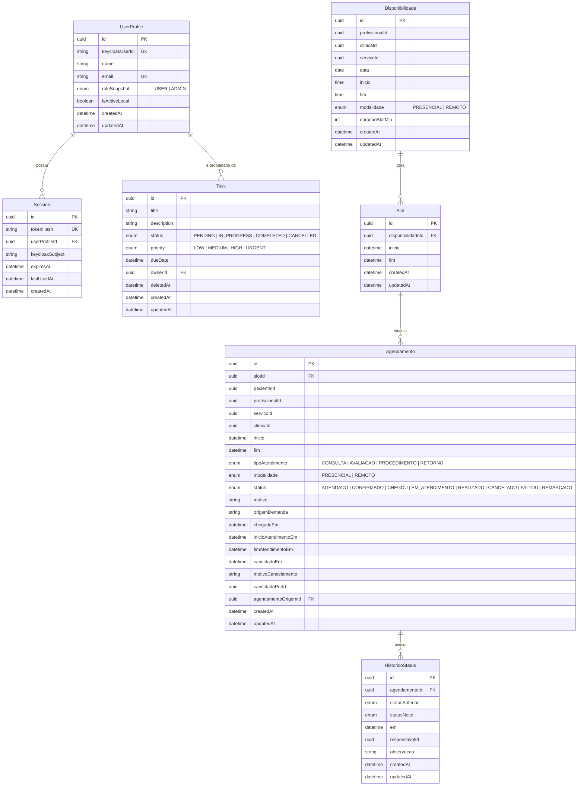

# Visão Geral da Arquitetura do AppStart

O **AppStart** é um template pedagógico de arquitetura de software full stack projetado para ensinar padrões profissionais de engenharia de software, segurança de identidade (OIDC/Keycloak), tipagem ponta a ponta e separação de responsabilidades.

---

## 🏗️ 1. Topologia do Sistema



---

## 🔐 2. Fluxo de Autenticação OIDC e Sessão BFF



---

## 🗄️ 3. Modelo de Dados Relacional (ER)



**Regras garantidas pelo banco** (migration `20261111_disponibilidade_sem_sobreposicao`, fora do `schema.prisma` porque o Prisma não modela `CHECK` nem `EXCLUDE`):

- `disponibilidades_fim_apos_inicio`: `fim > inicio`.
- `disponibilidades_sem_sobreposicao`: um profissional não tem duas disponibilidades com intervalos `[data+inicio, data+fim)` que se cruzam (`EXCLUDE USING gist`, extensão `btree_gist`). Janelas encostadas são permitidas.

Um slot está **ocupado** quando tem agendamento fora de `CANCELADO` e `REMARCADO` (RN01/RN04, constante `STATUS_QUE_LIBERAM_SLOT` em `apps/api/src/agendamentos/ocupacao-slot.ts`). Os horários de disponibilidade e slot são de America/Recife.

---

## 📋 4. Catálogo Canônico de Endpoints da API

| Método | Endpoint | Proteção | Papel Mínimo | Descrição |
| :--- | :--- | :--- | :--- | :--- |
| `GET` | `/health/live` | Público | - | Verificação de processo vivo (*liveness*) |
| `GET` | `/health/ready` | Público | - | Verificação de prontidão com banco (*readiness*) |
| `GET` | `/api/v1/auth/login` | Público | - | Inicia fluxo OIDC no Keycloak |
| `GET` | `/api/v1/auth/callback` | Público | - | Processa retorno do Keycloak e emite sessão |
| `GET` | `/api/v1/auth/me` | Sessão | `USER` | Consulta perfil e sessão ativa do usuário |
| `GET` | `/api/v1/auth/account` | Sessão | `USER` | Redireciona para o Console de Conta do Keycloak |
| `POST` | `/api/v1/auth/logout` | Sessão + CSRF | `USER` | Revoga a sessão local ativa |
| `POST` | `/api/v1/auth/logout-all` | Sessão + CSRF | `USER` | Revoga todas as sessões do usuário |
| `GET` | `/api/v1/admin/access-check` | Sessão | `ADMIN` | Verificação de privilégios administrativos |
| `GET` | `/api/v1/users` | Sessão | `ADMIN` | Listagem paginada e filtrada de usuários |
| `POST` | `/api/v1/users` | Sessão + CSRF | `ADMIN` | Provisiona novo usuário no Keycloak |
| `GET` | `/api/v1/users/:id` | Sessão | `ADMIN` | Detalhes de um usuário específico |
| `PATCH` | `/api/v1/users/:id` | Sessão + CSRF | `ADMIN` | Atualiza dados de um usuário |
| `PATCH` | `/api/v1/users/:id/status` | Sessão + CSRF | `ADMIN` | Ativa ou desativa um usuário |
| `PATCH` | `/api/v1/users/me` | Sessão + CSRF | `USER` | Autoatendimento de perfil (nome) |
| `GET` | `/api/v1/tasks` | Sessão | `USER` | Lista tarefas com paginação, busca e filtros |
| `POST` | `/api/v1/tasks` | Sessão + CSRF | `USER` | Cria nova tarefa com ownership |
| `GET` | `/api/v1/tasks/:id` | Sessão | `USER` | Detalhes da tarefa (owner ou admin) |
| `PUT` | `/api/v1/tasks/:id` | Sessão + CSRF | `USER` | Atualiza tarefa respeitando regras de transição |
| `DELETE`| `/api/v1/tasks/:id` | Sessão + CSRF | `USER` | Remoção lógica (*soft delete*) da tarefa |
| `POST` | `/api/v1/disponibilidades` | Shell (`ShellAuthGuard`) | `USER` | Cadastra a disponibilidade do profissional e gera os slots (US-01) |
| `GET` | `/api/v1/disponibilidades` | Shell (`ShellAuthGuard`) | `USER` | Lista disponibilidades com slots livres/ocupados, por profissional e período |
| `GET` | `/api/v1/agendamentos/:id` | Shell (`ShellAuthGuard`) | `USER` | Detalhe do agendamento: estado, horários, slot, participantes e histórico de status (DS-74) |
| `GET` | `/api/v1/perfil/me` | Sessão | - | Consulta perfil de negócio do usuário na Agenda (RECEPCAO ou PROFISSIONAL) (DS-64) |

### 4.1. Ações sobre agendamento (convenção)

Cada ação que muda um agendamento (confirmar, chegada, cancelar, falta, iniciar/encerrar, vincular estudante) fica na sua própria pasta. Assim as tasks andam em paralelo e os MRs só se encontram em pontos de registro triviais (ver regra 5).

```text
apps/api/src/agendamentos/
├── agendamento.dto.ts             AgendamentoDto: formato único de resposta
├── agendamento-detalhe.ts         INCLUDE_DETALHE + paraAgendamentoDto
├── agendamento-estado.service.ts  transicionar(): RN08 + campos + histórico, numa transação
├── agendamentos.service.ts        obterPorId()
├── agendamentos.controller.ts     GET /agendamentos/:id
└── acoes/
    ├── index.ts                   ACOES_CONTROLLERS e ACOES_PROVIDERS (uma linha por ação)
    └── <acao>/
        ├── <acao>.controller.ts   POST /agendamentos/:id/<acao>
        ├── <acao>.dto.ts          corpo da requisição, se houver
        ├── <acao>.service.ts      regra específica da ação
        └── <acao>.service.spec.ts
apps/api/test/agendamentos-<acao>.e2e-spec.ts
```

Regras para cada ação:

1. O controller usa `@Controller('agendamentos')`, rota `:id/<acao>` com `ParseUUIDPipe`. O responsável vem de `@CurrentUser()` (usuário do Shell).
2. O service valida a regra própria da ação e troca o estado **só** por `AgendamentoEstadoService.transicionar(id, novoStatus, usuario.id, observacao, campos)`. Nunca faz `update` de `status` direto. Os campos gravados junto com a troca (ex.: `chegadaEm`, `canceladoEm`) vão em `campos`. Só passam os listados em `CAMPOS_DA_TRANSICAO` (filtro em runtime, não só no tipo). Se a ação precisa de outro campo, acrescente-o nessa lista (e crie a migration se a coluna não existir).
3. A resposta é `paraAgendamentoDto(await transicionar(...))`: o `transicionar` relê o agendamento com `INCLUDE_DETALHE` **dentro da transação**, então a resposta mostra exatamente o que a ação gravou, no mesmo formato do GET (não chame `obterPorId` depois, que leria fora da transação). A tela T05 só substitui o agendamento exibido.
4. Erros: `400` validação, `404` agendamento inexistente e `409` transição não permitida ou alterada por outra operação (os dois últimos já saem do `transicionar`).
5. O MR acrescenta o seu controller e o seu service em `acoes/index.ts`, cataloga a rota na tabela acima e roda `pnpm api:generate`. Esses são os únicos pontos compartilhados e vão conflitar entre MRs paralelos: em `acoes/index.ts` e na tabela, mantenha as linhas dos dois lados; `openapi.json` e `apps/web/src/lib/api-client/` são gerados, então aceite a versão da `main` e rode `pnpm api:generate` de novo, sem editar na mão.

Rotas sugeridas para as tasks já abertas:

| Task | Pasta | Rota | Estado final |
| :--- | :--- | :--- | :--- |
| DS-41 | `confirmar/` | `POST /api/v1/agendamentos/:id/confirmar` | `CONFIRMADO` |
| DS-25 | `chegada/` | `POST /api/v1/agendamentos/:id/chegada` | `CHEGOU` |
| DS-29 | `atendimento/` | `POST /api/v1/agendamentos/:id/iniciar` e `.../encerrar` | `EM_ATENDIMENTO`, `REALIZADO` |
| DS-33 | `falta/` | `POST /api/v1/agendamentos/:id/falta` | `FALTOU` |
| DS-37 | `cancelar/` | `POST /api/v1/agendamentos/:id/cancelar` | `CANCELADO` |
| DS-57 | `vinculo/` | `PUT /api/v1/agendamentos/:id/vinculo` | sem troca de estado (não usa `transicionar`) |

---

## ⚙️ 5. Diferenças entre Desenvolvimento e Produção

| Aspecto | Ambiente de Desenvolvimento (`development`) | Ambiente de Produção (`production`) |
| :--- | :--- | :--- |
| **Formato de Logs** | Colorido e legível no terminal (`NestLogger`) | JSON Estruturado com `requestId`, `timestamp` e `level` |
| **Segredos e Credenciais** | Valores padrão documentados no `.env.example` | Variáveis injetadas via Vault, KMS ou CI/CD secrets |
| **Cookies de Sessão** | `Secure: false` (para suporte a `http://localhost`) | `Secure: true` (estritamente sobre conexões HTTPS) |
| **Swagger UI** | Habilitado em `/api/docs` | Desabilitado ou protegido sob firewall corporativo |
| **Banco de Dados** | Docker Compose local com seed (`pnpm db:seed`) | PostgreSQL gerenciado com backups e migrations via pipeline |
| **Keycloak** | Instância local Docker na porta `8080` com realm importado | IdP corporativo de alta disponibilidade com TLS |
